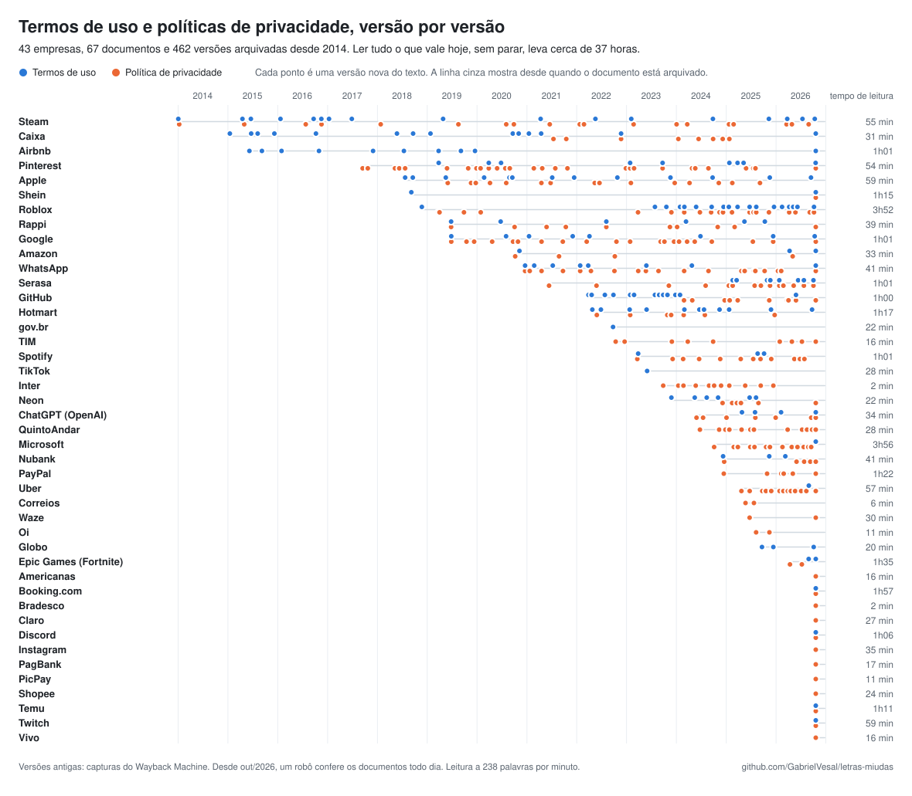

# Letras miúdas

Os termos de uso e as políticas de privacidade das empresas que o brasileiro mais usa, em
Markdown, com cabeçalho estruturado e o histórico de cada mudança. Um robô confere tudo todo dia.

<!-- RESUMO -->
**67 documentos de 43 empresas**, com **470 versões** arquivadas desde 2014. Ler tudo o que vale hoje, sem parar, leva **cerca de 36 horas**.
<!-- /RESUMO -->

O histórico do git é a própria linha do tempo: cada versão de cada documento é um commit, com a
data em que aquela versão foi vista pela primeira vez. Abra qualquer arquivo em
[`termos/`](termos/), clique em **History** e veja o que entrou e o que saiu.

<picture>
  <source media="(prefers-color-scheme: dark)" srcset="linha-do-tempo.svg">
  
</picture>

> [!IMPORTANT]
> Os textos são cópias das páginas oficiais, convertidas automaticamente para Markdown, e
> **não são orientação jurídica**. Vale o que está publicado no site de cada empresa: o link
> está no campo `fonte` do cabeçalho de cada arquivo.

---

## O acervo em números

<!-- NUMEROS -->
| Categoria | Empresas | Documentos | Versões arquivadas | Tempo de leitura |
| --- | ---: | ---: | ---: | ---: |
| Bancos | 8 | 11 | 63 | 3h30 |
| Compras | 5 | 8 | 14 | 3h39 |
| Apps | 6 | 9 | 58 | 5h33 |
| Redes sociais | 5 | 8 | 69 | 3h44 |
| Tecnologia | 4 | 8 | 95 | 6h56 |
| IA | 1 | 2 | 11 | 34 min |
| Streaming | 3 | 5 | 21 | 2h21 |
| Jogos | 3 | 6 | 78 | 6h21 |
| Telefonia | 4 | 4 | 14 | 1h10 |
| Serviços | 3 | 5 | 46 | 2h09 |
| Governo | 1 | 1 | 1 | 22 min |
| **Total** | **43** | **67** | **470** | **36h19** |
<!-- /NUMEROS -->

Para ver em gráficos o que mais mudou, o que mais cresceu, quanto tempo leva para ler cada
documento e quando cada empresa passou a falar de IA, biometria ou LGPD, abra a
**[página de estatísticas](https://gabrielvesal.github.io/letras-miudas/)**. É um arquivo
único ([`index.html`](index.html)), sem servidor nem dependência, gerado por `scripts/gerar.py`.
Os mesmos achados em texto estão em **[ACHADOS.md](ACHADOS.md)**, e cada mudança que o robô
encontra entra em **[MUDANCAS.md](MUDANCAS.md)**.

---

## Pergunte para a sua IA

Ninguém vai ler isso tudo na mão. O acervo foi feito para a sua IA ler por você.

**Um documento.** Abra o arquivo, clique em **Raw**, copie o link e cole no ChatGPT, Claude
ou Gemini (com acesso à web):

```text
Leia https://raw.githubusercontent.com/GabrielVesal/letras-miudas/main/termos/nubank/politica-de-privacidade.md
e me diga com quem o Nubank compartilha meus dados. Cite os trechos.
```

**O acervo todo.** Clone e abra a pasta no Claude Code, Cursor ou Codex:

```bash
git clone https://github.com/GabrielVesal/letras-miudas
cd letras-miudas
claude "quais empresas dizem usar meus dados para treinar IA? cite o trecho de cada uma"
```

Outras perguntas que funcionam bem: *"o que mudou na política de privacidade do WhatsApp
desde 2021?"*, *"quais bancos compartilham dados com birôs de crédito?"*, *"quem guarda minha
biometria e por quanto tempo?"*. Com o histórico do git, a IA consegue comparar versões
(`git log -p termos/whatsapp/politica-de-privacidade.md`).

**Como servidor MCP.** Pelo [GitMCP](https://gitmcp.io), serviço gratuito de terceiros, qualquer
cliente MCP lê o acervo direto do GitHub. No Cursor (`~/.cursor/mcp.json`):

```json
{
  "mcpServers": {
    "letras-miudas": { "url": "https://gitmcp.io/GabrielVesal/letras-miudas" }
  }
}
```

Para robôs e IAs, o índice está em **[`llms.txt`](llms.txt)** e a lista de todos os documentos e
de todas as versões, com o link do texto de cada uma, em
**[`dados/documentos.json`](dados/documentos.json)**.

---

## Empresas e documentos

<!-- EMPRESAS -->
| Empresa | Documentos | Arquivado desde | Versões |
| --- | --- | --- | ---: |
| **Bancos** | | | |
| Bradesco | [Política de Privacidade](termos/bradesco/politica-de-privacidade.md) | out/2026 | 1 |
| Caixa | [Política de Privacidade](termos/caixa/politica-de-privacidade.md) · [Termos de Uso](termos/caixa/termos-de-uso.md) | jan/2015 | 22 |
| Inter | [Política de Privacidade](termos/inter/politica-de-privacidade.md) | set/2023 | 11 |
| Neon | [Política de Privacidade](termos/neon/politica-de-privacidade.md) · [Termos de Uso](termos/neon/termos-de-uso.md) | nov/2023 | 12 |
| Nubank | [Política de Privacidade](termos/nubank/politica-de-privacidade.md) · [Termos de Uso](termos/nubank/termos-de-uso.md) | dez/2024 | 8 |
| PagBank | [Política de Privacidade](termos/pagbank/politica-de-privacidade.md) | out/2026 | 2 |
| PayPal | [Política de Privacidade](termos/paypal/politica-de-privacidade.md) | dez/2024 | 6 |
| PicPay | [Política de Privacidade](termos/picpay/politica-de-privacidade.md) | out/2026 | 1 |
| **Compras** | | | |
| Amazon | [Política de Privacidade](termos/amazon/politica-de-privacidade.md) · [Termos de Uso](termos/amazon/termos-de-uso.md) | out/2020 | 7 |
| Americanas | [Política de Privacidade](termos/americanas/politica-de-privacidade.md) | out/2026 | 1 |
| Shein | [Política de Privacidade](termos/shein/politica-de-privacidade.md) · [Termos de Uso](termos/shein/termos-de-uso.md) | set/2018 | 3 |
| Shopee | [Política de Privacidade](termos/shopee/politica-de-privacidade.md) | out/2026 | 1 |
| Temu | [Política de Privacidade](termos/temu/politica-de-privacidade.md) · [Termos de Uso](termos/temu/termos-de-uso.md) | out/2026 | 2 |
| **Apps** | | | |
| Airbnb | [Termos de Uso](termos/airbnb/termos-de-uso.md) | jun/2015 | 11 |
| Booking.com | [Política de Privacidade](termos/booking/politica-de-privacidade.md) · [Termos de Uso](termos/booking/termos-de-uso.md) | out/2026 | 3 |
| QuintoAndar | [Política de Privacidade](termos/quintoandar/politica-de-privacidade.md) | jun/2024 | 12 |
| Rappi | [Política de Privacidade](termos/rappi/politica-de-privacidade.md) · [Termos de Uso](termos/rappi/termos-de-uso.md) | jun/2019 | 16 |
| Uber | [Política de Privacidade](termos/uber/politica-de-privacidade.md) · [Termos de Uso](termos/uber/termos-de-uso.md) | abr/2025 | 14 |
| Waze | [Política de Privacidade](termos/waze/politica-de-privacidade.md) | jun/2025 | 2 |
| **Redes sociais** | | | |
| Discord | [Política de Privacidade](termos/discord/politica-de-privacidade.md) · [Termos de Uso](termos/discord/termos-de-uso.md) | out/2026 | 2 |
| Instagram | [Política de Privacidade](termos/instagram/politica-de-privacidade.md) | out/2026 | 1 |
| Pinterest | [Política de Privacidade](termos/pinterest/politica-de-privacidade.md) · [Termos de Uso](termos/pinterest/termos-de-uso.md) | set/2017 | 37 |
| TikTok | [Termos de Uso](termos/tiktok/termos-de-uso.md) | jun/2023 | 1 |
| WhatsApp | [Política de Privacidade](termos/whatsapp/politica-de-privacidade.md) · [Termos de Uso](termos/whatsapp/termos-de-uso.md) | dez/2020 | 28 |
| **Tecnologia** | | | |
| Apple | [Política de Privacidade](termos/apple/politica-de-privacidade.md) · [Termos de Uso](termos/apple/termos-de-uso.md) | jul/2018 | 28 |
| GitHub | [Política de Privacidade](termos/github/politica-de-privacidade.md) · [Termos de Uso](termos/github/termos-de-uso.md) | mar/2022 | 23 |
| Google | [Política de Privacidade](termos/google/politica-de-privacidade.md) · [Termos de Uso](termos/google/termos-de-uso.md) | jun/2019 | 29 |
| Microsoft | [Política de Privacidade](termos/microsoft/politica-de-privacidade.md) · [Termos de Uso](termos/microsoft/termos-de-uso.md) | out/2024 | 15 |
| **IA** | | | |
| ChatGPT (OpenAI) | [Política de Privacidade](termos/openai/politica-de-privacidade.md) · [Termos de Uso](termos/openai/termos-de-uso.md) | mai/2024 | 11 |
| **Streaming** | | | |
| Globo | [Termos de Uso](termos/globo/termos-de-uso.md) | set/2025 | 4 |
| Spotify | [Política de Privacidade](termos/spotify/politica-de-privacidade.md) · [Termos de Uso](termos/spotify/termos-de-uso.md) | mar/2023 | 15 |
| Twitch | [Política de Privacidade](termos/twitch/politica-de-privacidade.md) · [Termos de Uso](termos/twitch/termos-de-uso.md) | out/2026 | 2 |
| **Jogos** | | | |
| Epic Games (Fortnite) | [Política de Privacidade](termos/epic-games/politica-de-privacidade.md) · [Termos de Uso](termos/epic-games/termos-de-uso.md) | abr/2026 | 4 |
| Roblox | [Política de Privacidade](termos/roblox/politica-de-privacidade.md) · [Termos de Uso](termos/roblox/termos-de-uso.md) | nov/2018 | 38 |
| Steam | [Política de Privacidade](termos/steam/politica-de-privacidade.md) · [Termos de Uso](termos/steam/termos-de-uso.md) | jan/2014 | 36 |
| **Telefonia** | | | |
| Claro | [Política de Privacidade](termos/claro/politica-de-privacidade.md) | out/2026 | 1 |
| Oi | [Política de Privacidade](termos/oi/politica-de-privacidade.md) | ago/2025 | 2 |
| TIM | [Política de Privacidade](termos/tim/politica-de-privacidade.md) | out/2022 | 10 |
| Vivo | [Política de Privacidade](termos/vivo/politica-de-privacidade.md) | out/2026 | 1 |
| **Serviços** | | | |
| Correios | [Política de Privacidade](termos/correios/politica-de-privacidade.md) | mai/2025 | 2 |
| Hotmart | [Política de Privacidade](termos/hotmart/politica-de-privacidade.md) · [Termos de Uso](termos/hotmart/termos-de-uso.md) | abr/2022 | 18 |
| Serasa | [Política de Privacidade](termos/serasa/politica-de-privacidade.md) · [Termos de Uso](termos/serasa/termos-de-uso.md) | jun/2021 | 26 |
| **Governo** | | | |
| gov.br | [Termos de Uso](termos/govbr/termos-de-uso.md) | set/2022 | 1 |
<!-- /EMPRESAS -->

Falta alguma empresa? [Adicione](CONTRIBUTING.md): é um arquivo só.

---

## Estrutura

```
termos/<empresa>/politica-de-privacidade.md   o texto atual de cada documento
termos/<empresa>/termos-de-uso.md
empresas/<empresa>.json                       de onde vem cada documento: endereço e ajustes de extração
dados/documentos.json                         todos os documentos e todas as versões, com links
dados/linha-do-tempo.json                     as versões encontradas no Wayback Machine
dados/estado.json                             o resultado da última leitura de cada documento
llms.txt                                      índice para IAs
index.html                                    a página de estatísticas
linha-do-tempo.svg                            a imagem do topo deste README (e a versão -claro)
MUDANCAS.md                                   as mudanças que o robô encontrou
ACHADOS.md                                    os achados em texto
scripts/                                      o robô
```

---

## Formato dos arquivos

Todo arquivo tem cabeçalho YAML (o GitHub mostra como uma tabela) e, no corpo, o texto da
página oficial convertido para Markdown, sem edição:

```markdown
---
empresa: "Nubank"
documento: "Política de Privacidade"
categoria: "Bancos"
fonte: "https://nubank.com.br/transparencia/politicas-de-privacidade-e-seguranca/politica-de-privacidade"
capturado_em: 2026-09-12
wayback: "https://web.archive.org/web/20260912050648/https://nubank.com.br/..."
historico: "https://github.com/GabrielVesal/letras-miudas/commits/main/termos/nubank/politica-de-privacidade.md"
---

**Aviso de Privacidade - NU**
...
```

| Campo | O que é |
| --- | --- |
| `empresa`, `documento`, `categoria` | quem e o quê |
| `fonte` | a página oficial de onde o texto veio |
| `capturado_em` | o dia em que esta versão do texto foi vista pela primeira vez |
| `wayback` | só nas versões antigas: o link da captura no Wayback Machine, para conferir |
| `historico` | a lista de todas as versões no GitHub |

O que sai do texto: menu, rodapé, banner de cookies e botões. Em alguns documentos também sai
o que não vale para o Brasil, como avisos só para residentes nos EUA ou, no Airbnb, as versões
inteiras dos termos para a Europa e a Austrália. Esses ajustes ficam declarados em
`empresas/<empresa>.json` (`remover_linhas` e `cortar_em`), à vista de todos.

---

## O histórico do git

Cada versão de cada documento é um commit do `letras-miudas-bot`. Para ver o que mudou:

1. Abra o documento em [`termos/`](termos/) e clique em **History**.
2. Clique numa versão: vermelho saiu, verde entrou.

Pelo terminal:

```bash
git log -p termos/whatsapp/politica-de-privacidade.md     # todas as versões, com o diff
git log --format='%ad %s' --date=short -- termos/google/  # só as datas
```

O passado de cada documento foi reconstruído a partir do
[Wayback Machine](https://web.archive.org/): o robô leu uma captura por trimestre e, quando o
texto mudava, voltou mês a mês para achar quando a mudança apareceu. Cada commit antigo traz o
link da captura original. Desde outubro de 2026, as versões novas vêm da leitura diária.

> [!NOTE]
> **A data de cada versão é a da captura em que ela apareceu**, então indica quando o texto já
> estava no ar, não necessariamente o dia em que a empresa publicou. Mudança só de formatação,
> espaço ou caractere invisível não vira versão nova. Capturas parciais, testes A/B e versões
> de outro país também ficam de fora: se uma versão tira um trecho que volta logo depois, ela não
> é mudança de verdade. No Google, que muda a política conforme o país, fica só a versão para o
> Brasil.

Para não registrar alarme falso, uma mudança vista pelo robô só entra se o texto ainda parecer o
documento (tamanho, vocabulário, português), se não tiver encolhido pela metade de uma vez, se
aparecer igual em duas leituras seguidas e se continuar igual na rodada do dia seguinte.

---

## Fontes

| Fonte | O que vem dela |
| --- | --- |
| Páginas oficiais de cada empresa | o texto atual, lido todo dia (endereços em `empresas/`) |
| [Wayback Machine](https://web.archive.org/) (Internet Archive) | as versões antigas, desde 2015 |

O robô se identifica (`letras-miudas/1.0`, com link para este repositório), respeita o
`robots.txt`, lê cada página uma vez por dia e **não contorna bloqueios anti-robô**.

---

## Empresas que ainda não estão aqui

Testadas em outubro de 2026 e deixadas de fora:

| Motivo | Empresas |
| --- | --- |
| O site recusa acesso automatizado (erro 403, captcha ou verificação anti-robô) | Itaú, Banco do Brasil, Santander, C6 Bank, XP, Banco Pan, Sicredi, Magalu, Casas Bahia, Carrefour, OLX, iFood, 99, inDrive, Zé Delivery, Decolar, Canva, Duolingo, Betano |
| O `robots.txt` proíbe robôs | X (Twitter), Facebook, LinkedIn, Netflix, Disney+ |
| A página só mostra parte do texto; o resto abre com JavaScript, por partes ou em abas | Mercado Livre, Mercado Pago, termos de uso do QuintoAndar |
| Servem a versão em inglês para servidores fora do Brasil | Deezer, AliExpress, Telegram |

Se você conhece um endereço oficial que serve o texto sem bloqueio (um PDF, por exemplo),
[abra uma issue](https://github.com/GabrielVesal/letras-miudas/issues).

---

## Reproduzir e atualizar

```bash
pip install -r requirements.txt
python -m playwright install chromium              # para as páginas que só abrem com navegador

python scripts/coletar.py --sem-commit             # lê todos os documentos de novo
python scripts/historico.py --empresas nubank      # busca o histórico de uma empresa nova no Wayback
python scripts/gerar.py                            # README, llms.txt, índices, imagem e página
```

O GitHub Actions roda isso todo dia ([`.github/workflows/coletar.yml`](.github/workflows/coletar.yml)).
Resumo das mudanças por IA é opcional: configure os secrets `RESUMO_API_URL` (qualquer API
compatível com a de chat da OpenAI), `RESUMO_API_KEY` e `RESUMO_MODELO`.

A ideia vem do [Open Terms Archive](https://opentermsarchive.org/), que acompanha termos de
serviço na Europa.

---

## Licença

Código sob [MIT](LICENSE). Os textos pertencem às empresas e estão aqui para fins de
transparência, pesquisa e interesse público. Projeto independente, sem vínculo com nenhuma
delas. Detalhes em [AVISO.md](AVISO.md).
